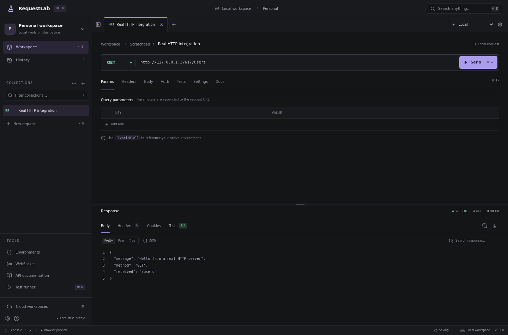

# RequestLab

**A local-first API development workspace.** Build, send, inspect, and test requests without creating an account. This repository started as Rustflow and now contains the RequestLab desktop application, optional SaaS portal/API, and manual billing administration.

> **Status: engineering beta, not a production-ready release.** The browser workspace and TypeScript API are tested. Native Rust/Tauri code is implemented but has not been compiled in the supplied environment. Desktop-to-cloud background synchronization is not connected. Read the [delivery report](docs/DELIVERY.md) and [feature status](docs/ROADMAP.md) before evaluating or deploying.



_Screenshot from the real HTTP integration test, not fabricated response data. The browser preview uses Node, not the Rust engine._

## What works

- Multi-tab request editing; common and custom methods; query parameters and headers.
- JSON, XML, plain-text, and raw URL-encoded bodies; lazily loaded offline Monaco editing.
- Basic, bearer, and API-key header authentication; global/environment variable resolution.
- Real HTTP execution, timeouts, cancellation, and a 5 MiB response cap.
- Response text, formatted JSON, expandable JSON trees, search, headers, cookies, copy, and binary download.
- Persistent collections, request moving/reordering, duplication, local history metadata, import/export, and two themes.
- Post-response assertions in a no-I/O QuickJS WASM VM, inside a dedicated worker; sequential collection runner and JSON reports.
- Browser/native WebSocket transports; message inspection; native handshake headers.
- **Subset** of OpenAPI 3.0/3.1 JSON import and basic 3.0.3 export; no claim of complete specification compatibility.
- Separate Next.js cloud portal and Fastify API: verified-email accounts, password resets, sessions, workspaces, invitations, roles, ownership transfer, comments, activity, and versioned/idempotent change APIs.
- Manual payment references, pending/reviewed status, explicit authorized approval, expiry/cancellation, and an admin portal. Default contact: **56668672**. No payment gateway, invented transactions, or card storage.

Missing and unverified features are listed explicitly in [ROADMAP.md](docs/ROADMAP.md).

## Quick start: runnable browser workspace

Requires **Node 22.13+** (the development SQLite bridge uses `node:sqlite`) and npm.

```bash
npm ci
npm run dev
# http://localhost:5173
```

The development server binds to `0.0.0.0` for remote development previews. Requests execute on the **development machine**, not inside the browser. The bridge intentionally permits local development destinations. **Do not deploy this server, expose it without authentication, or enter production secrets.** Production frontend builds contain no preview bridge.

Create a request, enter a URL, and Send. Internet access is not required when targeting your own local API. Data is stored in `.data/preview.db`. Browser cookies/CORS do not constrain the development bridge's HTTP execution; the native runtime also executes outside browser CORS.

## Native desktop development

Install stable Rust and the [platform prerequisites](docs/deployment/DESKTOP.md), then:

```bash
npm ci
npm run desktop
```

Generate production installers **on each target OS**:

```bash
npm run desktop:build
# apps/desktop/src-tauri/target/release/bundle/
```

The native path uses Tauri IPC → Rust Reqwest/Rustls → destination; SQLite and the OS credential vault stay behind Rust commands. It does not use the development HTTP bridge. Rust compilation and installer generation were **not possible in this sandbox**. No signed installers are supplied.

## Cloud development

Requires a separately provisioned PostgreSQL 17 instance and an SMTP relay. The desktop never connects to PostgreSQL.

```bash
cp .env.example .env
# Set DATABASE_URL, APP_ORIGIN, SMTP_URL, and MAIL_FROM in your shell or secret manager.
# For local shell use only: set -a; . ./.env; set +a
npm run db:migrate
npm run dev:web       # Next.js portal and same-origin /api/v1/* API, port 3000
# In another shell with the same environment:
npm run jobs          # verification/reset/invitation email outbox worker
```

`npm run dev:api` optionally runs the same API as a separate Fastify service on port 3001. The portal normally embeds it via a server-side route adapter; do not expose two independently rate-limited API entrances in production.

After registering and verifying the owner account, explicitly bootstrap an administrator:

```bash
npx tsx services/api/src/admin.ts YOUR_VERIFIED_ADMIN_EMAIL
```

There are no default users, seeded administrator passwords, or pre-approved subscriptions. See [deployment and recovery](docs/deployment/CLOUD.md) for Docker, HTTPS, backups, and administrator actions.

## Quality checks

```bash
npm run typecheck
npm test
npm run build
npm run build:web
npm audit
npm run format:check
npx playwright install --with-deps chromium
npm run test:e2e
npm run benchmark

cd apps/desktop/src-tauri
cargo fmt --all -- --check
cargo clippy --all-targets -- -D warnings
cargo test
cargo audit
```

The API suite uses real PostgreSQL compiled to WASM (PGlite) by default. Set `TEST_DATABASE_URL` to a **dedicated empty disposable PostgreSQL database** to run the same suite against a PostgreSQL server. CI is configured to run both. The tests create accounts and records; never point them at production.

For restricted Linux sandboxes without browser-download access, the optional npm-packaged Chromium fallback is available:

```bash
REQUESTLAB_SANDBOX_BROWSER=1 npm run test:e2e
```

The fallback is test tooling only. It does not disable browser web security.

## Architecture & repository

```text
apps/desktop/               React/Vite desktop UI
  src/components/          Request builder, inspector, tools, accessible primitives
  src/lib/                 IPC, variables/contracts, OpenAPI, test isolation
  src/workers/             Bounded no-I/O script execution
  src-tauri/               Rust HTTP, SQLite/vault, WebSocket, native capabilities
apps/web/                   Next.js account/team/billing/admin portal
services/api/src/           Fastify security boundary, domain routes, database, jobs
packages/shared/            Strict request models, validation, variable resolution
database/migrations/        PostgreSQL schema
infrastructure/             Containers and reverse-proxy configuration
tests/                      Core, API integration, real HTTP/WebSocket browser tests
tools/                      Development bridge, benchmarks, test-browser helper
docs/                       Architecture, API, security, deployment, delivery status
.github/workflows/          Quality checks and manual cross-platform artifact builds
```

[Architecture](docs/architecture/OVERVIEW.md) · [Database](docs/architecture/DATABASE.md) · [API](docs/api/README.md) · [Security](docs/security/THREAT_MODEL.md) · [Contributing](CONTRIBUTING.md)

### Technology decisions

Tauri 2/Rust, Tokio, Reqwest/Rustls, Rusqlite, keyring, React 19, strict TypeScript, Vite, Lucide, Motion, Monaco, Radix accessible dialog/menu primitives, QuickJS WASM, Next.js, Fastify, PostgreSQL, and SMTP outbox jobs. UI styles use Tailwind CSS plus explicit design-token CSS, a shadcn-style Button primitive, and Radix dialog/menu primitives. This is a small application-specific component layer, not a claim that the full shadcn component catalog is installed.

SQLite stores a versioned workspace aggregate plus a request index, not the full normalized target model. This keeps initial persistence transactional but requires further optimization before very large workspaces. See the documented trade-offs.

## Security notes

TLS verification is enabled; native cross-origin redirects are blocked. Credentials have no place in logs or persisted response bodies. Native secret fields use the OS vault; **preview storage is not encrypted**. Exports remove known credential fields and secret-marked variables, but cannot detect a secret embedded in arbitrary body text, URLs, documentation, or scripts. Always review exports before sharing. Cloud secret synchronization and cloud-side HTTP execution are deliberately unavailable.

The software has not received an independent security audit. Dependency advisories, native verification, operational hardening, and signing remain release gates. Report issues according to [SECURITY.md](SECURITY.md).

## License

[MIT](LICENSE). Third-party dependencies retain their own licenses. Branding and distribution policy should be reviewed before a commercial release.
